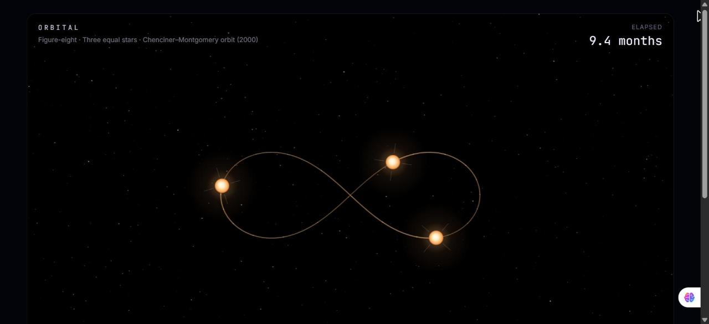
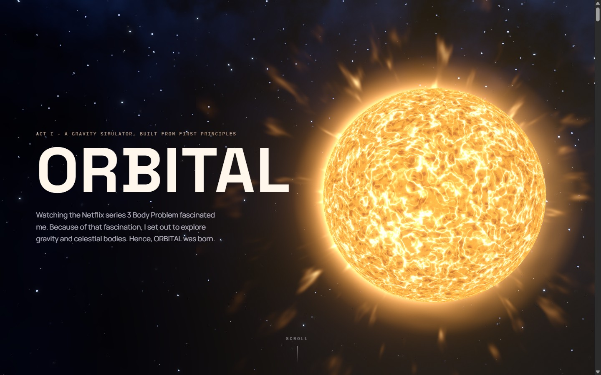

# ORBITAL

**Live demo: [orbital-nbody.vercel.app](https://orbital-nbody.vercel.app)**



**The story: [orbital-nbody.vercel.app/story.html](https://orbital-nbody.vercel.app/story.html)**

The story page gives every viewer, whatever their knowledge of physics, a pictorial and visual representation of the maths and physics behind the simulation.



Orbital is an interactive 2D Newtonian N-body gravity simulator, built from first principles with React and TypeScript and drawn on HTML5 Canvas. It is 2D physics drawn with 3D-style shading. Orbital simulates gravity's effect on celestial bodies (stars and planets) as time changes.

Each body's acceleration at a given time depends on where the other bodies are at that moment. For this reason, the velocity and position change continuously with time. From Newton's law of gravitation, we use the formula for force to get accelerations. Through Velocity Verlet, we take a really small step in time, Δt, which helps us get new positions and velocities, and the process is repeated. Only the acceleration is gotten purely mathematically, so it is exact. The position and velocity are approximated because, as accurate as Velocity Verlet can be, there is a minor accumulation of errors.

To interact with it, you select a model from the three available. Then set a time warp that shows you what happens over a long period of time in the model, but in seconds in real time. That way, you can observe how the bodies move over a long period in just a short time. Below the simulation, a stats strip shows the elapsed time, energy drift, momentum drift, precision and frame rate.

The physics engine is responsible for the mathematical calculations behind the visual rendering. On the other hand, the visual rendering draws these bodies and their positions with 3D-style shading. It doesn't change positions; it only reads them.

---

## Why I built it

Watching the Netflix series 3 Body Problem fascinated me. Three bodies moving under each other's gravity can look simple to the eye. Through analysis it becomes far more unpredictable. I wanted to translate my curiosity into a visual representation that helps people understand the effects of gravity. A simulator lets me do that while being backed up by accurate code and mathematics.

Although a three-body system is chaotic there are rare solutions. The figure-eight preset models one of them. It shows how these bodies can move and still be predicted. The prediction may not be perfect but it is accurate enough for observation and study.

By the end I hope to become very familiar with how far calculus can take us. I want to explore how long a prediction stays trustworthy before the errors from each time step grow too large. I also hope to stumble onto a new possibility. Maybe three-body problems can be modelled differently to find other solutions for long-term observation.

## The physics

ORBITAL uses Newton's Law of Universal Gravitation which states:

$$\mathbf a_i = \sum_{j \ne i} G\, m_j \,\frac{\mathbf r_j - \mathbf r_i}{|\mathbf r_j - \mathbf r_i|^3}$$

r_j - r_i is the vector from body i to body j. Its length is the distance between the centres of the bodies, but here we treat them as point masses according to Newton's shell theorem. The acceleration is in the correct direction because each body is pulled towards the other body, meaning for body i the acceleration points from i to j. The denominator is |r| cubed because we multiply the unit vector of r by 1/r².

The j != i means we do not include the body itself. When calculating the acceleration of body i we are summing the accelerations caused by all other bodies except itself. A body cannot exert a force upon itself and including this would make both the numerator (r_i - r_i) and the denominator zero, giving 0/0.

Taking all bodies as point masses is realistic due to Newton's shell theorem. Any planets or stars can be treated as a point mass in space. Any spherical object will attract an external mass with the same force as if the entire mass was concentrated at the centre. This holds for both hollow spheres and solid spheres with the same mass, but will only be accurate if the object is spherically symmetrical and the mass is external. Real stars will have some bulge around their equator due to their rotation, so this is very accurate but not completely accurate.

As G = 1, M = 1 and r = 1 AU, 2π is the time taken for Earth to make one orbit around the Sun. v = 1 so period = 2π/1.

Epsilon stops us getting NaN when d = 0. The constant ensures there is no massive leap in acceleration when the bodies are close together. In reality gravity will become massive over small distances. However the simulator uses a constant time step of Δt. This means that if two bodies get very close together, one time step will cause a massive leap in one of the bodies. Softening avoids this ridiculous situation by reducing the gravity slightly at very small distances. This is a modelling choice as it sacrifices some accuracy at small distances for a stable simulation. Presets do not have any softening as they will not collide anyway. They are far enough away so it is not needed.

ORBITAL does not simulate 3D movement, Einstein's relativity, collisions/merging, tidal forces or actual sizes and shapes of bodies. It is not a planetary or system model. It simply shows how gravity affects objects over time.

## The numerical method

The formula gives the acceleration, but the simulator needs positions. Two equations connect them:

$$\frac{d\mathbf r}{dt} = \mathbf v \qquad \frac{d\mathbf v}{dt} = \mathbf a(\mathbf r)$$

The equations show that the rate of change (derivative) of position is velocity and the rate of change of velocity is acceleration. Most three-body problems are chaotic in nature. Although a few have solutions like the figure-eight modelled here, Bruns and Poincaré proved in the 1880s and 1890s that no general formula exists to predict the position of the bodies over time. So the simulator moves the bodies forward in small time steps Δt.

### Euler's method

$$\mathbf r_{new} = \mathbf r + \mathbf v\,\Delta t \qquad \mathbf v_{new} = \mathbf v + \mathbf a\,\Delta t$$

Euler's method calculates the velocity and acceleration at the start of each step and then uses those same values for the whole step. During the step the real velocity and acceleration keep changing, but Euler ignores this, which causes so much error.

The extra energy accumulates over time. This is because the velocity at the start of the step is used for the whole step, so the body moves in a straight line in the old direction and drifts off the curve. On a circle of radius 1 a straight step of 0.01 lands at a distance of about 1.00005 from the centre, slightly outside the circle. Every step lands outside and never inside, so the errors add up instead of cancelling.

### Velocity Verlet

$$\mathbf v_{1/2} = \mathbf v + \mathbf a(\mathbf r)\,\frac{\Delta t}{2} \qquad \mathbf r_{new} = \mathbf r + \mathbf v_{1/2}\,\Delta t \qquad \mathbf v_{new} = \mathbf v_{1/2} + \mathbf a(\mathbf r_{new})\,\frac{\Delta t}{2}$$

Lines 10 to 20 of `integrator.ts` do one Verlet step. First a new velocity is found by adding half a step of acceleration to the original v. This half velocity is used to calculate the new position. The acceleration is then calculated again at the new position, and the second half is added to get the final velocity. So each step uses the acceleration at both the start and the end of the step instead of only the start like Euler. Halving Δt reduces Euler's error by half, Verlet's by a fourth and RK4's by a sixteenth.

As a symplectic integrator Verlet keeps the total energy oscillating within a small band over time, preventing secular drift.

RK4 may be more accurate per step but it is not symplectic. Its energy error is very small but it slowly grows in one direction, so over centuries of simulated time the drift adds up. It is also less efficient because it needs four force calculations per step while ORBITAL's Verlet needs two. For long runs, keeping the energy error bounded matters more than getting a better approximation each step.

### The evidence

Both methods were run on the same circular orbit (Sun of mass 1, planet at distance 1, Δt = 0.01) for 10 orbits:

| Method | Largest energy error during the run | Energy error at the end | Final radius (should be 1) |
|---|---|---|---|
| Euler | 40.6% | 40.6% | 1.648 |
| Velocity Verlet | 2.4 × 10⁻⁹ | 1.1 × 10⁻¹⁵ | 1.0000000001 |

Euler's largest error is its final error because the error only ever grew. Verlet's error rose during each orbit and came back down, which is the bounded band in action.

These numbers come from `src/physics/euler.test.ts`. To reproduce them run:

```bash
npx vitest run src/physics/euler.test.ts --silent=false
```

## How I know it's correct

A simulator also shows visuals. It might be right in code but wrong visually, and code that runs without errors can still give the wrong physics. So the tests compare the simulation against things physics already tells us, such as my own hand calculation, the conservation of energy and momentum, and known orbital periods:

| Test | What it checks |
|---|---|
| Two-body acceleration | Matches my hand calculation (a₁ = (0.048, 0.064)) to 10 decimal places |
| Newton's third law | m₁a₁ + m₂a₂ = 0 |
| Softening | Overlapping bodies give finite numbers, not NaN |
| Energy conservation | Relative energy error stays below 10⁻⁶ after 10 orbits |
| Orbital period | A circular orbit returns to its start after one period of 2π, to 3 decimal places |
| Binary star | Two equal stars stay 1 AU apart to 4 decimal places at every one of 20,000 steps |
| Figure-eight | Three stars return within 0.0001 of their starting positions after the published period (T ≈ 6.3259) |
| Momentum | Every preset starts with total momentum below 10⁻⁷, and it stays below 10⁻⁹ while the figure-eight runs |
| Euler vs. Verlet | Euler gains over 30% energy and spirals out, while Verlet's energy error never rises above 10⁻⁸ |
| Time warp | Big time jumps are split into steps that cover the time exactly |

The app also shows energy drift and momentum drift live. This shows the model's accuracy at any given time. Energy and momentum should stay exactly constant, so the drift shows just how far the numbers are from the exact physics while it runs.

## Features

- **Presets:** Sun and Earth with the real mass ratio, a binary star, and the Chenciner–Montgomery figure-eight three-body orbit (2000)
- **Time warp** from 1 day/s to 1 century/s, with an elapsed-time clock in days, months, years and centuries
- **Accuracy readout:** at extreme speeds the computer can't keep Δt small, so the Precision indicator and energy drift show the trade-off between speed and accuracy
- **Live stats:** elapsed time, energy drift, momentum drift, precision and frame rate
- Fading orbit trails, play, pause and reset, and a layout that works on phones

## Project structure

```
src/
├─ physics/     pure maths and physics, no drawing code, fully tested
│  ├─ vec2.ts         2D vector operations
│  ├─ gravity.ts      pairwise gravitational acceleration (+ softening)
│  ├─ integrator.ts   Velocity Verlet step
│  ├─ euler.ts        Euler step, kept for comparison
│  ├─ energy.ts       total kinetic + potential energy
│  ├─ momentum.ts     total linear momentum
│  ├─ presets.ts      starting conditions
│  ├─ units.ts        simulation time ↔ years
│  └─ timeWarp.ts     years-per-second → integrator steps
├─ render/      Canvas drawing: starfield, shaded bodies, trails
├─ components/  React UI: control dock and stats strip
├─ SimCanvas.tsx  the simulation loop that ties it together
└─ story/       the story page: 3D scenes, scroll chapters and live checks
                that run the same physics code
```

The physics never imports anything from the rendering or UI code, so it can be tested on its own.

## Run it locally

```bash
npm install
npm run dev        # start the app at http://localhost:5173
npm test           # run the test suite once
```

## What I learned

The biggest thing I learned has to be calculus on a deeper level. Learning that precalculus and Calculus 1 have applications that can be used to derive predictions of the laws governing the universe is amazing. I also loved learning about Euler's method conceptually, seeing how it was improved and then building a real-time application to model it. Predicting how a function will behave over time without knowing its exact solution is a clever way to study phenomena in our universe that have their roots in rates of change. It is exciting to see my rough notes on ODEs leave the page and become working code a computer understands. That code does repeated calculations with principles that allow us to model reality.

Creating this also taught me that a system working in code doesn't always translate to smooth visual rendering.

All in all, what surprised me the most was finding out that there are actually three-body problems with solutions. Although they are rare, they still exist.

## Built with

React · TypeScript · Vite · HTML5 Canvas · Vitest

Story page: three.js with React Three Fiber · GSAP and ScrollTrigger · Lenis · KaTeX

---

Rhema · 2026
